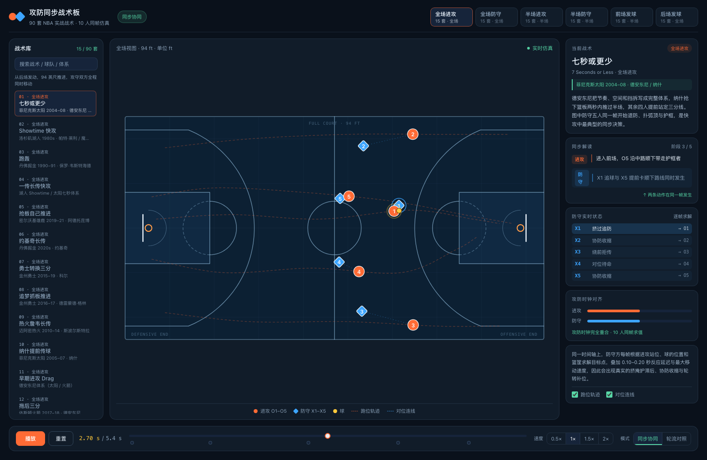
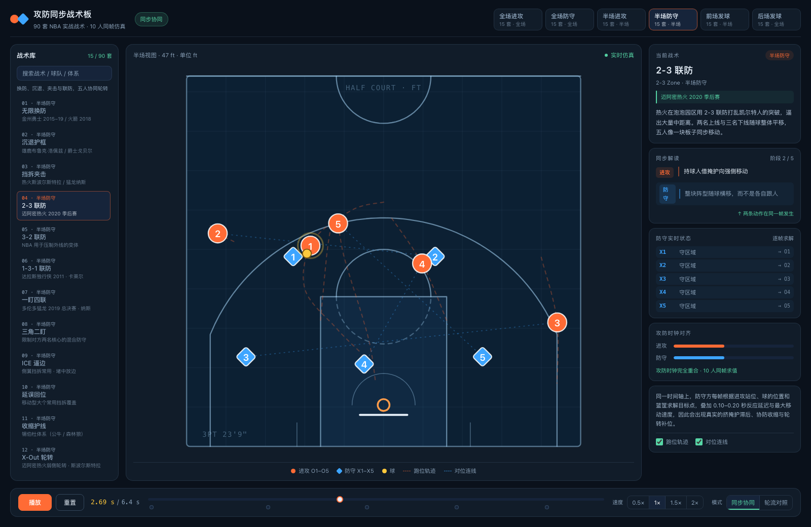
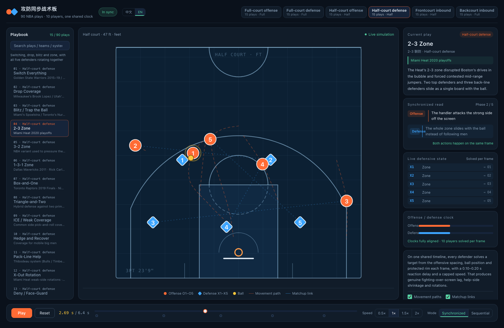

# NBA Tactics Board

An interactive basketball tactics board covering **90 NBA plays** across six categories, with a synchronized offense/defense simulation and a full Chinese/English interface.

All 9 playable files are plain static assets — no build step, no dependencies. Open `index.html` directly in a browser,
or click https://Jason-Muxin-Han.github.io/NBA-Tactics-Board/ to see it.

## Preview



| Half-court defense (2-3 zone) | English interface |
| --- | --- |
|  |  |

## What it does

- **90 plays, 6 categories, 15 each**: full-court offense, full-court defense, half-court offense, half-court defense, frontcourt (baseline) inbound, backcourt inbound. Every play carries a short Chinese/English note on the NBA team, era and personnel that actually used it.
- **One shared clock for all 10 players.** Offense follows Catmull-Rom keyframed routes and a ball-possession timeline; defenders have no preset destination — each frame they solve a target from the current offensive positions, ball and basket, with 0.10–0.20 s reaction delay and a max speed cap. Result: real fight-over slips, help rotations and closeouts instead of moving in turns.
- **Court auto-switches**: a horizontal 94-ft full court for full-court plays, a vertical half court for the rest.
- **Zone and pressure rules**: 2-3 / 3-2 / 1-3-1 zones, box-and-one, traps, blitz, drop coverage, switch-everything, scram and more.
- **Controls**: play/pause, 0.5–2× speed, scrubbable timeline with phase ticks, trails and matchup links toggles, category tabs, cross-category search, and a "turn-based (legacy)" comparison mode that shows how lagging defense looks.
- **Bilingual UI**: top-bar 中文 / EN switch covers every label, all 90 play descriptions and 456 phase commentaries. Choice persists in `localStorage` and the URL hash, e.g. `#play=zone23&t=0.42&lang=en`.

## Files

```
index.html            entry page
css/style.css         styles, dark theme, responsive dashboard layout
js/i18n.js            bilingual dictionary (UI, 90 descriptions, 456 commentaries)
js/catalog.js         90-play catalog (name, team, era, source note)
js/templates.js       parameterized motion skeletons for 86 plays
js/plays.js           raw data for 4 hand-authored plays
js/court.js           half-court and full-court SVG drawing
js/engine.js          synchronized simulation and defensive reaction rules
js/main.js            rendering and interaction
screenshots/          preview images
```

## Run locally

Double-click `index.html`, or serve the directory:

```bash
python3 -m http.server 8000
# visit http://localhost:8000
```

## GitHub Pages

In **Settings → Pages → Build and deployment**, set Source to `main` / `root`. The site will be available at `https://<username>.github.io/Nba-Tactics-Board/`.

## Note

Play names, teams and eras are taken from published basketball terminology and documented team systems. Motion is an illustrative reconstruction of each scheme's structure, not a frame-by-frame reproduction of game footage. Plays without a widely documented specific game are labeled as generic NBA ATO playbook sets rather than attributed to a particular match.

## License

MIT — see [LICENSE](LICENSE).
